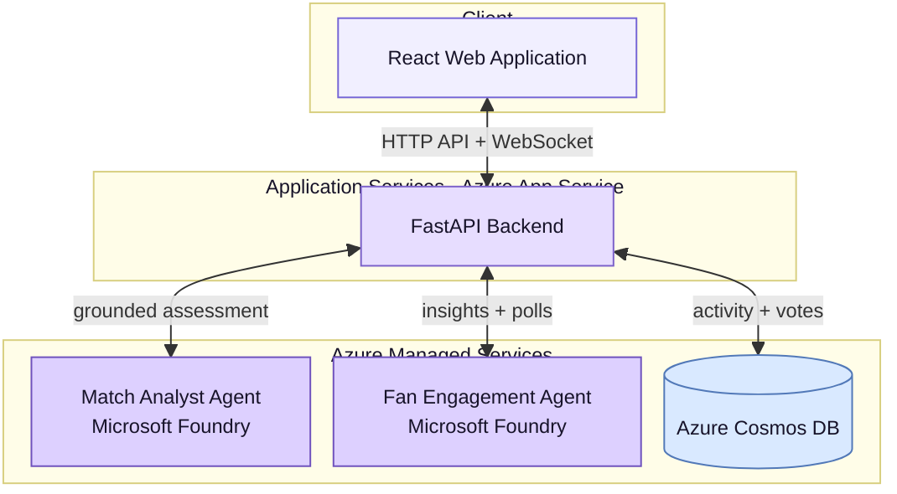
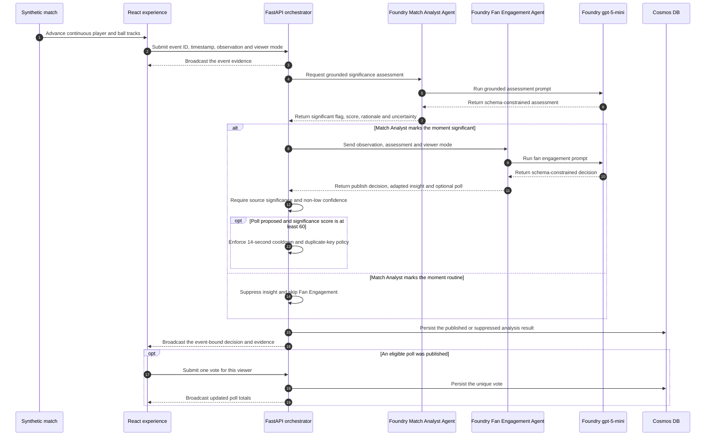

# FanPulse

**Your Voice in the Game.** FanPulse turns a synthetic football match into grounded, timely and personalised intelligence for the people watching it.

Built for the **Microsoft × Premier League Inside the Game Hackathon**, FanPulse combines a continuously animated fictional match, two real Microsoft Foundry agents, evidence-aware publishing policy and live audience voting in one synchronized viewing experience.

> **Live application:** [app-fanpulse-dev-qdifh3qv.azurewebsites.net](https://app-fanpulse-dev-qdifh3qv.azurewebsites.net/)
>
> **Hackathon path:** Select **Synthetic** (the default). It uses fictional match data and real Foundry agents—the complete experience for judging.

## What FanPulse does

Football is better when fans can do more than watch. Every attack, recovery and tactical change creates an opinion: *Was that move dangerous? Should the team press higher? What should happen next?* FanPulse turns those moments into a shared, interactive conversation alongside the match.

- **Understand the moment.** The Foundry Match Analyst Agent identifies meaningful play and explains why it matters while the action is still relevant.
- **See the match your way.** Casual mode makes the story immediately accessible; Tactical mode gives detail-hungry viewers deeper football context.
- **Have your say.** The Foundry Fan Engagement Agent turns significant moments into timely, balanced questions that invite viewers into the experience.
- **Compare your view with the crowd.** Fans vote live and see the shared response update, revealing whether others read the game the same way.
- **Stay connected to the action.** Every insight and vote remains synchronized with the exact play that inspired it, instead of becoming a disconnected second-screen discussion.
- **Build a richer fan community.** The same platform can bring together casual supporters, tactical thinkers and passionate fans around a common moment without forcing everyone into the same experience.

The hackathon experience brings that vision to life through a continuous 240-second fictional match with all 22 players and the ball in motion. Real Foundry agents interpret its synchronized observations at runtime; the insights and polls are not pre-written answers.

For broadcasters and streaming platforms, FanPulse demonstrates a reusable interaction layer that can turn live match events into audience-specific storytelling without separating fans from the action.

## Component architecture

### One complete hackathon pipeline

FanPulse implements the five stages in the challenge as one synchronized experience:

| Stage | FanPulse implementation |
| --- | --- |
| **Ingest** | Read fictional player, ball and event data against a shared live match clock |
| **Interpret** | Use the Match Analyst Agent to assess significance, context and uncertainty |
| **Explain** | Use the Fan Engagement Agent to turn meaningful moments into grounded narratives and balanced questions |
| **Render** | Show insights, evidence and polls beside the animated match at the moment that triggered them |
| **Personalize** | Adapt each explanation for Casual or Tactical viewers without changing the underlying evidence |

## How it works

The diagram below follows one Synthetic match moment from start to finish. The Match Analyst Agent reviews the event evidence, scores its significance from 0 to 100, and explains why it matters. It must use only the supplied match information and cannot invent new facts.

Routine moments stop there. Significant moments move to the Fan Engagement Agent, which creates a viewer-friendly explanation and may suggest a live poll. Polls require a significance score of at least 60 and must pass the backend's confidence, cooldown and duplicate checks before appearing.

This diagram focuses on Synthetic mode, the experience used for hackathon judging.

### The two Foundry agents

FanPulse uses two persisted Microsoft Foundry agents, each with one clear job:

| Agent | Receives | Responsibility | Structured output |
| --- | --- | --- | --- |
| **Match Analyst** | One validated football observation | Decide whether the moment is significant, explain why, and state any uncertainty without inventing match facts | `MatchAssessment` |
| **Fan Engagement** | Observation, assessment and viewer mode | Turn significant moments into audience-friendly insights and, when appropriate, a balanced poll | `FanEngagementDecision` |

Both agents are powered by the keyless `gpt-5-mini` deployment in Microsoft Foundry. Their prompts are version-controlled in [`ai/agents/`](ai/agents/), and JSON Schema keeps their responses predictable for the application.

### What appears to the viewer?

- A routine or low-confidence moment is recorded but not shown as an insight.
- A significant moment can become Live Intelligence after the Fan Engagement Agent explains it.
- A poll appears only when the score is at least 60 and the backend confirms it is timely and not a duplicate.
- If Foundry is unavailable, FanPulse reports the problem instead of displaying a made-up answer.

### Personalisation and live voting

Viewers can choose **Casual** for a clear, simple explanation or **Tactical** for deeper football context. Both views are based on the same match evidence.

When a poll appears, each viewer can vote once and watch the shared totals update live. This lets fans compare their reading of the game with the wider audience without leaving the match.

## Synthetic data

Synthetic mode reads fictional match events directly from the authored dataset and sends their structured observations to the real Foundry agents at runtime.

The judged simulation is stored separately from the application code in [`reference-match.v1.json`](apps/web/public/simulations/reference-match.v1.json). It contains:

- 22 fictional players and one continuously moving ball;
- a four-minute match timeline with passes, carries, recoveries and pressure;
- twelve observations synchronized to the visible action; and
- no real footage, real tracking data or pre-written agent answers.

FanPulse keeps every insight and poll synchronized with the play that triggered it. A shared match clock, event IDs and controlled agent requests prevent stale results, mismatched commentary and unnecessary Foundry load.

The full dataset, animation and timing design is documented in [`docs/SYNTHETIC_MATCH.md`](docs/SYNTHETIC_MATCH.md).

## Honest boundaries

- The judged experience contains one authored fictional match, not a general-purpose match generator.
- Synthetic observations are authored with the animation; the Foundry assessments, insights and polls are generated live.
- Casual and Tactical modes change the explanation, not the underlying match evidence.
- A production-scale release would add user authentication and a shared WebSocket backplane.

## Hackathon compliance

- The judged experience uses only fictional teams, players, movement and match observations.
- The judged experience uses no match footage, real tracking data, club branding or third-party football assets.
- AI-generated insights are labelled in the interface and grounded in visible event evidence.
- The public application opens on Synthetic mode and is available to judges without sign-in.

See [`docs/COMPLIANCE.md`](docs/COMPLIANCE.md) and the [official rules](https://github.com/microsoft/insidethegamehackathon/blob/main/OFFICIAL%20RULES.md) for the full submission checklist.

## Technology stack

| Layer | Technology | Purpose |
| --- | --- | --- |
| Experience | React, TypeScript, Vite, Motion, SVG | Playback controls, continuous pitch animation, insights, timeline and voting |
| API | Python, FastAPI, Pydantic | Validation, playback sessions, orchestration, policy and WebSockets |
| AI | Microsoft Foundry, Foundry prompt agents, `gpt-5-mini` | Significance assessment, grounded explanation and fan engagement |
| Data | Azure Cosmos DB for NoSQL | Analysis activity and one-vote-per-viewer poll persistence |
| Azure | App Service, managed identity, Application Insights | Keyless hosting and monitoring |
| Delivery | Bicep and GitHub Actions with OIDC | Repeatable infrastructure, testing and deployment |

## Further documentation

- [`docs/SYNTHETIC_MATCH.md`](docs/SYNTHETIC_MATCH.md) — match schema, interpolation and synchronization behavior
- [`docs/ARCHITECTURE.md`](docs/ARCHITECTURE.md) — runtime orchestration, publishing policy and agent contracts
- [`ai/agents/README.md`](ai/agents/README.md) — declarative agent definitions and publication
- [`docs/GITHUB_DEPLOYMENT.md`](docs/GITHUB_DEPLOYMENT.md) — CI/CD, OIDC, delivery and rollback
