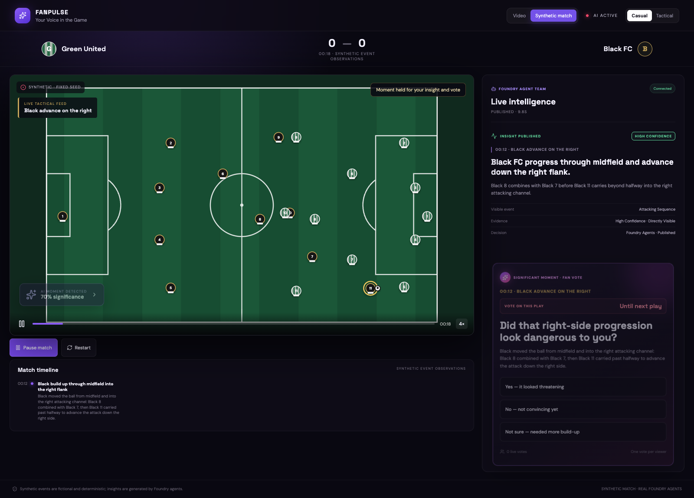
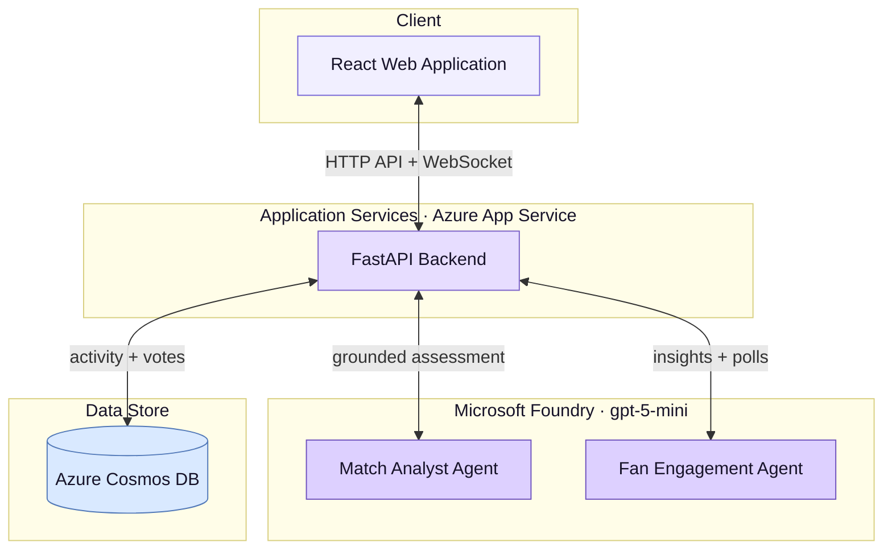
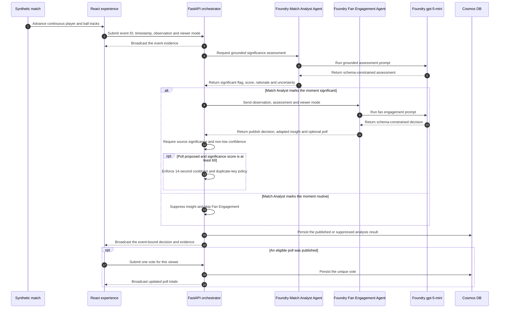
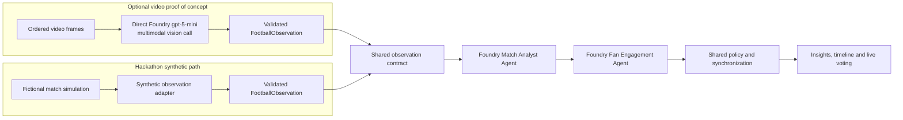
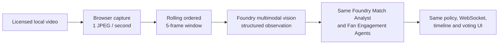

# FanPulse



**Your Voice in the Game.** FanPulse turns a synthetic football match into grounded, timely and personalised intelligence for the people watching it.

Built for the **Microsoft × Premier League Inside the Game Hackathon**, FanPulse combines a continuously animated fictional match, two real Microsoft Foundry agents, evidence-aware publishing policy and live audience voting in one synchronized viewing experience.

> **Live application:** [app-fanpulse-dev-qdifh3qv.azurewebsites.net](https://app-fanpulse-dev-qdifh3qv.azurewebsites.net/)
>
> **Hackathon path:** Select **Synthetic** (the default). It uses fictional match data and real Foundry agents. The separate Video mode is an optional technical demonstration and is explicitly excluded from the hackathon submission and judging.

## What FanPulse does

Football is better when fans can do more than watch. Every attack, recovery and tactical change creates an opinion: *Was that move dangerous? Should the team press higher? What should happen next?* FanPulse turns those moments into a shared, interactive conversation alongside the match.

- **Understand the moment.** The Foundry Match Analyst Agent identifies meaningful play and explains why it matters while the action is still relevant.
- **See the match your way.** Casual mode makes the story immediately accessible; Tactical mode gives detail-hungry viewers deeper football context.
- **Have your say.** The Foundry Fan Engagement Agent turns significant moments into timely, balanced questions that invite viewers into the experience.
- **Compare your view with the crowd.** Fans vote live and see the shared response update, revealing whether others read the game the same way.
- **Stay connected to the action.** Every insight and vote remains synchronized with the exact play that inspired it, instead of becoming a disconnected second-screen discussion.
- **Build a richer fan community.** The same platform can bring together casual supporters, tactical thinkers and passionate fans around a common moment without forcing everyone into the same experience.

The hackathon experience brings that vision to life through a continuous 240-second fictional match with all 22 players and the ball in motion. Real Foundry agents interpret its synchronized observations at runtime; the insights and polls are not pre-written answers.

## Component architecture



### Two ways in. One real AI pipeline.

FanPulse can understand a match in two different ways:

1. **Video mode (demonstration only—not part of hackathon judging):** While a video plays, the browser captures a small image once per second. Five images are grouped together and sent securely to the FanPulse backend. Microsoft Foundry examines them and describes what is happening on the pitch.
2. **Synthetic mode:** No video or images are used. FanPulse reads fictional player movements, ball movements and match events from the synthetic dataset. These are converted into the same structured match description that the video analysis would produce.

From that point onward, both modes work in exactly the same way. The same real Foundry Match Analyst Agent decides whether the moment matters. If it does, the same real Foundry Fan Engagement Agent explains it to the viewer and may create a live poll.

Synthetic mode uses fictional match events as its input, while the Foundry agents interpret each moment and generate fresh insights and polls during playback.

The React application controls what the viewer sees. FastAPI acts as the secure middle layer between the browser, Microsoft Foundry and Cosmos DB. The browser never contacts the AI model directly.

> **Video provides images. Synthetic mode provides fictional events. Both become the same match observation and enter the same real Foundry agent pipeline.**

## How it works

FanPulse separates deterministic match state from AI interpretation. The browser owns the animation and match clock; FastAPI validates and orchestrates each event; Foundry decides whether the moment matters and how to explain it; Cosmos DB and WebSockets make the resulting interaction durable and shared.

The sequence below follows one synthetic play from movement on the pitch to a personalised insight and audience vote. It intentionally begins with a structured observation because the judged Synthetic path replaces frame capture and vision. The optional Video path and its frame transfer are documented in the **Synthetic data** section below.



At the event timestamp, the browser posts a validated `FootballObservation` to `/api/analysis/sessions/{session_id}/synthetic`. Synthetic mode deliberately enters the pipeline **after** the computer-vision boundary: no rendered animation frames or tracking coordinates are sent to a model. FastAPI invokes the persisted Match Analyst and Fan Engagement agents, and Foundry runs each agent against the configured `gpt-5-mini` deployment.

There is no additional direct `gpt-5-mini` call in the Synthetic path. The direct multimodal model call belongs to the optional Video path, where FastAPI sends an ordered frame window to the Foundry Responses API to produce the shared observation before invoking the same two agents.

There are no hard-coded agent answers, polls or fallback insights. If Foundry is unavailable, the UI reports the failure instead of fabricating a result.

### Significance and publishing decisions

Significance is not inferred from the animation by the browser. It passes through explicit model and server-side gates:

| Decision | Owner | Effect |
| --- | --- | --- |
| Is the source event potentially meaningful? | Validated `FootballObservation` | `is_significant=false` or `confidence=low` forces suppression, regardless of later agent output. |
| Is the moment meaningful in football terms? | Foundry Match Analyst Agent | Returns a `significant` boolean, a 0–100 score, rationale and uncertainty. A routine result stops the pipeline before Fan Engagement, saving a second model call. |
| Should an insight be shown? | Foundry Fan Engagement Agent + FastAPI policy | Fan Engagement returns `publish_insight`; FastAPI re-applies the source-evidence and confidence gates before publishing. |
| Should viewers be asked to vote? | Foundry Fan Engagement Agent + deterministic FastAPI policy | A poll is eligible only for a published insight with significance **60 or higher**, then must also pass the 14-second cooldown and duplicate-key checks. |

The model explains why a moment matters, while deterministic backend policy retains final control over what is published and whether a poll can open.

### The five-stage hackathon pipeline

| Stage | FanPulse implementation |
| --- | --- |
| **1. Ingest** | Load a versioned fictional match containing player tracks, ball tracks and timestamped football observations. |
| **2. Interpret** | Send the current structured observation to the Foundry Match Analyst for a grounded significance assessment. |
| **3. Explain** | Pass the observation and assessment to the Fan Engagement agent, which produces concise copy and an optional poll. |
| **4. Render** | Deliver the result over WebSocket and render it beside the matching action, with evidence and uncertainty visible. |
| **5. Personalise** | Use the selected Casual or Tactical mode to control the language and depth of the generated explanation. |

## The two-agent team

The deployed Foundry portal assets are generated from version-controlled definitions in [`ai/agents/`](ai/agents/). Prompts live in YAML, responses are constrained by JSON Schema, and Python owns orchestration rather than embedding prompt text.

| Agent | Receives | Responsibility | Structured output |
| --- | --- | --- | --- |
| **Match Analyst** | One validated football observation | Decide whether the visible moment is significant, provide a short summary and rationale, and state uncertainty without inventing match facts | `MatchAssessment` |
| **Fan Engagement** | Observation, assessment and viewer mode | Publish or suppress an insight, adapt its language, and optionally create a neutral poll for sufficiently significant moments | `FanEngagementDecision` |

Both agents use the `foundry-multimodal` model profile, currently mapped to a keyless `gpt-5-mini` Global Standard deployment in Microsoft Foundry. Agent definitions use minimal reasoning effort and strict token and response limits to control latency and cost.

The provisioning process hashes the resolved YAML definition and JSON Schema. It creates a new immutable Foundry agent version only when that configuration has changed.

## Synthetic data

FanPulse was originally designed to analyse video. In that path, the browser captures one compressed JPEG frame per video second and builds a rolling window of five ordered frames from the current playback position. It submits that window, including each frame's video timestamp and playback generation, to `/api/analysis/sessions/{session_id}/windows`. FastAPI validates the payload and sends the frame content directly to the configured multimodal `gpt-5-mini` deployment in Microsoft Foundry. The model returns a schema-constrained `FootballObservation` describing only what it can see: the event type, team in possession, field zone, description, evidence, confidence and whether the moment appears significant.

Frames are transient inference input. FanPulse does not persist them in Cosmos DB; it stores the structured analysis activity and votes. FastAPI allows only one vision inference at a time, keeps only the newest pending window for each playback session, and discards a result if playback has moved more than 15 video seconds beyond it.

The rest of FanPulse was deliberately designed not to depend on video. It depends on that validated observation contract.

For the hackathon, the video and vision stage is replaced by a fictional synthetic-data adapter. At the correct point in the simulated match, the adapter emits the **same `FootballObservation` schema that the Foundry vision path would produce**. It then enters the same downstream production pipeline:



This means synthetic mode is not a recording of pre-generated Foundry answers. Only the fictional match movement and source observations are authored data. The significance assessment, personalised explanation and optional poll are generated at runtime by the real deployed Foundry agents.

| Pipeline stage | Video mode | Synthetic mode |
| --- | --- | --- |
| Source | Ordered JPEG frames captured from playback | Fictional player, ball and event data |
| Observation producer | Foundry multimodal vision | Deterministic synthetic adapter |
| Shared contract | `FootballObservation` | `FootballObservation` |
| Match interpretation | Real Foundry Match Analyst Agent | Same real Foundry Match Analyst Agent |
| Fan presentation | Real Foundry Fan Engagement agent | Same real Foundry Fan Engagement agent |
| Delivery | Same validation, policy, WebSocket and timeline | Same validation, policy, WebSocket and timeline |
| Voting | Same durable vote service | Same durable vote service |

This boundary makes the system input-agnostic: a licensed video analyser, a tracking-data provider or a live event feed can all produce the observation contract without requiring the agent and fan-experience layers to be rebuilt. For the judged experience, FanPulse uses only the synthetic path.

### Dataset and animation design

The match source is [`apps/web/public/simulations/reference-match.v1.json`](apps/web/public/simulations/reference-match.v1.json). Match content is external to the rendering code and validated when loaded.

It contains:

- fictional team metadata and 11 players per team;
- timestamped keyframes for every player across one continuous 240-second timeline;
- one continuous ball track containing carries, passes and holds;
- twelve stable events with a start time, observation time and safe hold point; and
- the structured observation associated with each event.

Coordinates use metres on a 105 × 68 metre pitch. Player movement uses shape-preserving cubic interpolation, which produces continuous motion without overshooting authored positions. Passes travel linearly so the ball does not ease unnaturally in flight. Carries attach the ball to the controlling player’s interpolated foot position.

One clock drives the pitch, event labels, progress bar and Foundry submissions. A phase change never swaps to a new position track, so there is no teleport back to a play’s starting position.

### Keeping animation and intelligence synchronized

Foundry inference is slower and less predictable than browser animation. FanPulse handles that explicitly:

1. An event is submitted only after its described action is visible.
2. Only one synthetic agent request can be outstanding.
3. Requests are separated by at least ten real seconds, independent of playback speed.
4. The clock may pause at a safe hold point while the matching result completes and remains readable for at least six seconds.
5. An 18-second waiting timeout releases playback visibly, while the outstanding request remains reserved until it actually completes.
6. Every request and response carries the event ID and playback generation.
7. Seeking or restarting advances the generation, causing results from the previous timeline to be discarded.
8. The poll closes when its play changes; historical insights remain in the Match Timeline.

These controls keep the visible play, Live Intelligence card and vote attached to the same event while preventing a slow model from increasing request concurrency.

## Personalisation and live voting

The mode selector changes the `viewer_mode` submitted with each observation:

| Mode | Intended presentation |
| --- | --- |
| **Casual** | Accessible language, concise explanation and minimal tactical terminology |
| **Tactical** | Deeper football context for viewers who want to understand the shape and consequence of the play |

When the Fan Engagement agent returns a valid poll, FastAPI applies server-side eligibility rules before publishing it. A browser-generated viewer ID permits one vote per viewer and poll. Production votes are stored in Azure Cosmos DB and updated totals are broadcast to every connected WebSocket client. Local development uses SQLite with the same interface.

## Correctness, safety and cost controls

- **Strict inputs:** Pydantic rejects unknown fields, malformed observations, unordered timestamps, oversized frames and invalid JPEG payloads.
- **Strict outputs:** Both agents return JSON matching checked-in schemas; invalid model output is not displayed.
- **Grounding:** Prompts prohibit invented scores, identities, outcomes, statistics and tactical claims that are absent from evidence.
- **Server policy:** Significance thresholds, evidence requirements, cooldowns and semantic duplicate keys are enforced outside the model.
- **Generation control:** Pause, seek, reset and restart state prevent stale results from crossing playback timelines.
- **Bounded work:** Agent and vision execution are globally single-flight; video sessions retain only the newest pending window.
- **Explicit failure:** Provider and validation errors are surfaced. The product has no fake-success fallback path.
- **Keyless identity:** Local development uses `DefaultAzureCredential`; Azure uses managed identity. No Foundry, Cosmos DB or Storage keys are stored in the repository.
- **Durable voting:** Cosmos DB uses a unique vote ID per poll and viewer, preventing repeat votes.
- **Separated deployments:** Application delivery never publishes Foundry definitions, and Foundry delivery never redeploys the application.

## Optional video proof of concept

Video mode demonstrates an alternative upstream input and is **not part of the hackathon submission**. The UI shows this warning before the footage is loaded and keeps a persistent exclusion banner visible in the mode.



The browser is authoritative for playback position. Each pause, seek or reset advances a generation and clears the frame buffer. FastAPI accepts at most one active inference and keeps only the newest pending window. Results more than 15 video seconds behind the browser position are discarded.

This proves that another observation producer can be placed upstream without changing the agent, policy, persistence or presentation layers. Supply only footage for which you hold all required rights.

## Technology stack

| Layer | Technology | Purpose |
| --- | --- | --- |
| Experience | React, TypeScript, Vite, Motion, SVG | Playback controls, continuous pitch animation, insights, timeline and voting |
| API | Python, FastAPI, Pydantic | Validation, playback sessions, orchestration, policy and WebSockets |
| AI | Microsoft Foundry, Foundry prompt agents, `gpt-5-mini` | Vision observation, significance assessment and fan engagement |
| Data | Azure Cosmos DB for NoSQL; SQLite locally | AI activity and one-vote-per-viewer poll persistence |
| Hosting | Azure App Service | One deployable React/FastAPI application |
| Infrastructure | Bicep and Azure Developer CLI | Foundry, model, App Service, Cosmos DB, Storage, identities and monitoring |
| Identity | Microsoft Entra ID, GitHub OIDC, managed identity | Keyless developer, CI/CD and runtime access |
| Observability | Application Insights and Log Analytics | Foundry agent traces and Azure diagnostics |
| Delivery | GitHub Actions | CI, application deployment and independently controlled Foundry publication |

## Repository layout

```text
fanpulse/
├── apps/
│   ├── web/                       React application and synthetic playback
│   │   ├── public/simulations/    Versioned fictional match dataset
│   │   ├── src/                   UI, pitch, interpolation and controller
│   │   ├── tests/                 Deterministic motion/controller tests
│   │   └── browser-tests/         End-to-end Chromium tests
│   └── api/                       FastAPI application
│       ├── app/analysis/          Queueing, agents, policy and synchronization
│       └── tests/                 API, orchestration and storage tests
├── ai/
│   ├── agents/                    YAML definitions, schemas and provisioner
│   ├── models/                    Logical model deployment profiles
│   ├── vision/                    Multimodal frame analysis
│   ├── evaluations/               Static evaluation definition and dataset
│   └── tests/                     Configuration and vision tests
├── infra/                         Bicep modules and Azure parameters
├── docs/                          Architecture, deployment and compliance notes
├── scripts/                       Local development and diagnostic utilities
└── .github/workflows/             CI and separated deployment pipelines
```

## API surface

| Endpoint | Purpose |
| --- | --- |
| `GET /api/health` | Revision, AI readiness and selected activity store |
| `POST /api/analysis/sessions/{id}/state` | Update playback generation, position and play/pause state |
| `POST /api/analysis/sessions/{id}/synthetic` | Submit an event-bound fictional observation to the two-agent pipeline |
| `POST /api/analysis/sessions/{id}/windows` | Submit an ordered browser-frame window to the optional vision pipeline |
| `GET /api/polls/{poll_id}/results` | Read current poll totals |
| `POST /api/votes` | Cast one viewer vote and broadcast the updated totals |
| `WS /ws` | Receive analysis status, insights, polls and vote updates |

## Test and validate

The normal validation path does not call paid Foundry inference.

```bash
# Python API, storage, AI configuration and vision tests
python -m pytest apps/api/tests ai/tests -q

# Validate declarative model/agent/evaluation files without publishing
python -m ai.provision

# React lint, deterministic playback tests, production build and browser tests
cd apps/web
npm run lint
npm test
npm run build
npm run test:browser

# Compile the Azure infrastructure template
cd ../..
az bicep build --file infra/main.bicep --stdout >/dev/null
```

Synthetic tests inspect the entire match at 60 fps, position and velocity boundaries, ball control, event evidence, delayed responses, request rate at multiple playback speeds, voting, pause, seek and restart behavior. Browser tests intercept transport only inside Playwright; those fixtures cannot become a product fallback.

An optional manual smoke test sends at most two synthetic observations through the real deployed Foundry agents:

```bash
cd apps/web
node scripts/synthetic-foundry-smoke.mjs
```

## Evaluation

[`ai/evaluations/`](ai/evaluations/) contains a six-case static dataset captured from representative pipeline outputs and a version-controlled Foundry evaluation definition. It measures grounded observation quality and poll decisions without replaying the video path.

Real evaluation is intentionally manual because it invokes billable inference. The protected **Deploy Foundry solution** workflow publishes changed agent/evaluation definitions, runs the evaluation and uploads its report.

## Delivery and deployment

FanPulse separates changes by responsibility:

| Workflow or command | Responsibility | Trigger |
| --- | --- | --- |
| **Continuous integration** | Validate Foundry configuration, run Python and web tests, build React, run Playwright, compile Bicep | Pull requests and pushes to `main` |
| **Deploy web application** | Build and deploy the tested React/FastAPI artifact to Azure App Service | Manual, `main` only |
| **Deploy Foundry solution** | Publish changed immutable agent versions and evaluation definition, then run the static evaluation | Manual, `main` only |
| `azd provision` | Create or update Azure resources, identities, RBAC and model deployment | Explicit local operation after reviewing `what-if` |

GitHub Actions signs into Azure using workload identity federation. No client secret, publish profile or storage key is required. Application deployment does not invoke Foundry or alter agent versions. See [`docs/GITHUB_DEPLOYMENT.md`](docs/GITHUB_DEPLOYMENT.md) for setup and rollback.

## Azure infrastructure

The Bicep modules provision:

- Microsoft Foundry account and project in Australia East;
- `gpt-5-mini` Global Standard deployment;
- the Foundry project and model used by two separately versioned prompt agents;
- Azure App Service with a system-assigned managed identity;
- serverless Azure Cosmos DB for activity and votes;
- private Azure Blob Storage for optional licensed video;
- Application Insights and a 30-day Log Analytics workspace; and
- least-privilege Entra role assignments for developers, runtime identities and GitHub OIDC.

Validate infrastructure changes before applying them:

```bash
az bicep build --file infra/main.bicep
az deployment group what-if \
  --resource-group rg-fanpulse-dev \
  --template-file infra/main.bicep \
  --parameters infra/main.parameters.json
```

Then provision explicitly with `azd provision`. Application and Foundry workflows never run `azd up`.

## Foundry configuration lifecycle

Validate definitions locally without contacting Azure:

```bash
python -m ai.provision
```

After changing a model profile, provision the Bicep-managed deployment first. After changing an agent prompt or schema, publish through the protected Foundry workflow. For controlled local recovery only:

```bash
source .venv/bin/activate
export PYTHONPYCACHEPREFIX="$PWD/.cache/python"
set -a
source .azure/fanpulse-dev/.env
set +a
python -m ai.provision --apply
```

Publishing is idempotent when the latest Foundry version already matches the checked-in configuration hash. A reverted definition becomes a new immutable version, making rollback explicit and auditable.

## Limitations and production path

- The synthetic scenario is one authored reference match rather than a match generator.
- Observations are authored alongside the fictional animation; computer vision is bypassed in the submission path.
- Viewer modes change language depth, not which events a viewer is allowed to receive.
- WebSocket broadcasts are currently process-local; a horizontally scaled deployment would need a shared backplane.
- Session orchestration is held in process memory, while accepted activity and votes are durable.
- Production exposure beyond the judged demo would require authentication, per-user authorization, rate limits and broader load testing.

These boundaries are intentional and visible. FanPulse demonstrates a complete, working path from synthetic football evidence to real agent interpretation, synchronized presentation and audience participation without claiming that the reference match is live tracking data.

## Hackathon compliance

- The judged Synthetic mode uses fictional teams, players, coordinates and observations.
- Video mode and its outputs are visibly marked as an excluded technical demonstration.
- No match footage is committed to the repository.
- AI-generated observations and insights are labelled in the interface.
- The demo video must remain under two minutes and avoid unlicensed footage, music and trademarks.
- The public application and repository must remain freely accessible through the judging period.

See [`docs/COMPLIANCE.md`](docs/COMPLIANCE.md) for the engineering checklist and re-check the [official rules](https://github.com/microsoft/insidethegamehackathon/blob/main/OFFICIAL%20RULES.md) before submission.

## Further documentation

- [`docs/SYNTHETIC_MATCH.md`](docs/SYNTHETIC_MATCH.md) — match schema, interpolation and synchronization behavior
- [`docs/ARCHITECTURE.md`](docs/ARCHITECTURE.md) — vision path, runtime policy and agent contracts
- [`ai/agents/README.md`](ai/agents/README.md) — declarative agent definitions and publication
- [`ai/evaluations/README.md`](ai/evaluations/README.md) — evaluation dataset and runner
- [`infra/README.md`](infra/README.md) — Azure resources, identities and provisioning
- [`docs/GITHUB_DEPLOYMENT.md`](docs/GITHUB_DEPLOYMENT.md) — CI/CD, OIDC, delivery and rollback
